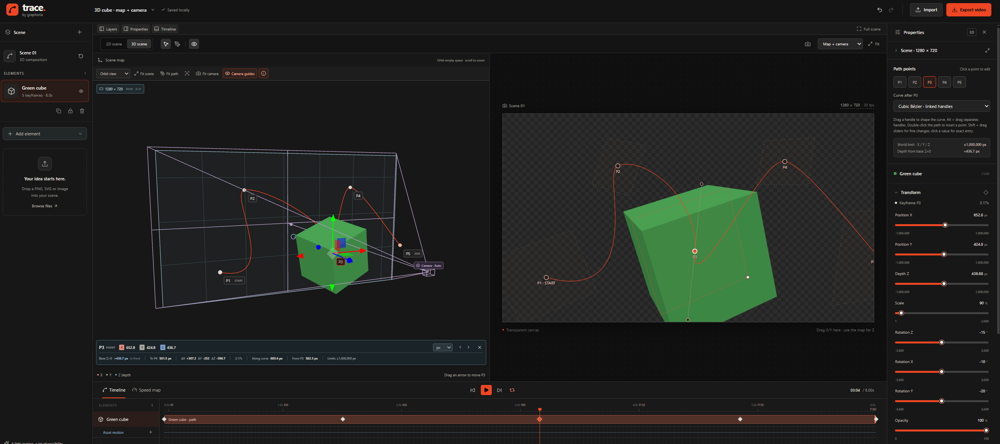
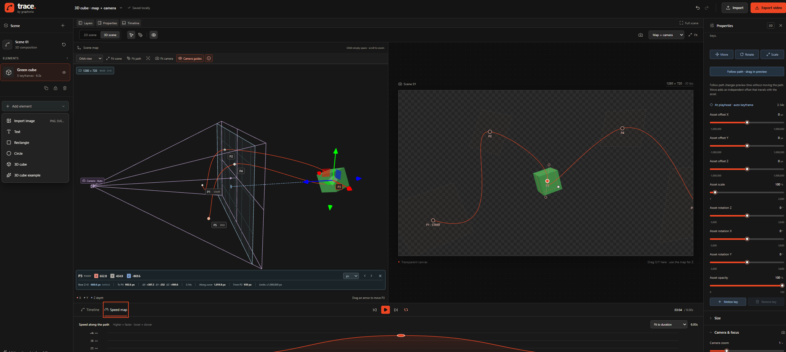
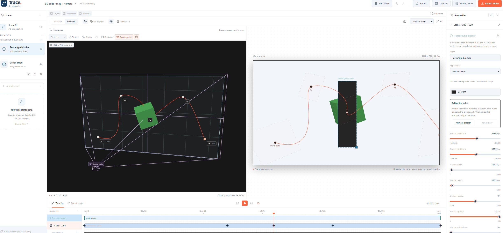
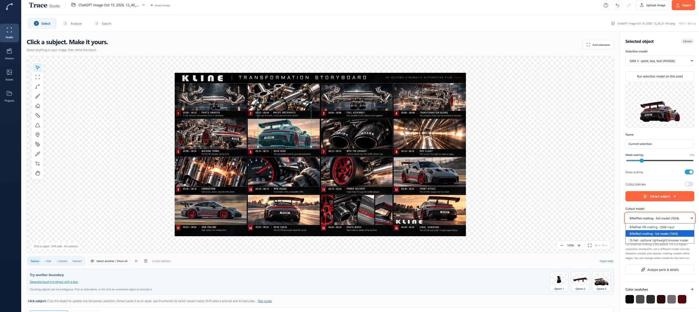
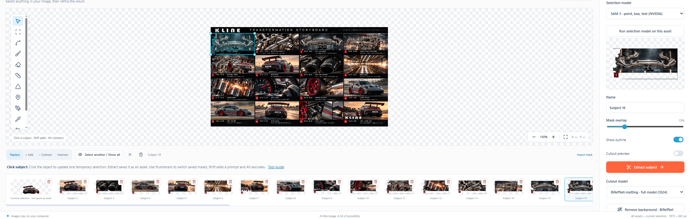
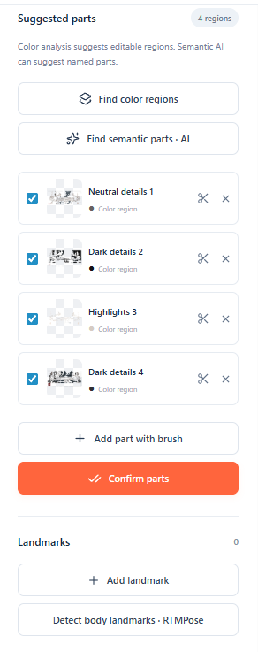

# Trace Studio

[](https://www.typescriptlang.org/)
[](https://react.dev/)
[](https://threejs.org/)
[](server/README.md)

**Extract subjects from images, then animate them in 2D or 3D.**

Trace Studio combines image selection, cutouts and reference analysis with a browser-based motion editor. Send a transparent asset straight from Image Studio into Motion Studio, composite it over footage, and export a video or an editable project. Browser editing works on its own. An optional local Python service adds more AI models.



## What you can do

### Image Studio

- **Select and extract.** Upload, paste or drop a PNG, JPEG, WebP or SVG. Select a subject by point, box or freehand, refine it with brush and eraser, and save it as a transparent cutout. Add, subtract or intersect masks and review alternate boundaries.
- **Analyze parts and proportions.** Build editable part masks, sample palettes, measure distances and angles, add landmarks, edit SVG contours and rectify a four-corner perspective plane. Calibrate the scale to measure in centimeters.
- **Clean up and export.** Refine edge transparency with matting, fill a removed region, compare an imported cutout with its reference, and export PNGs, masks, SVGs or a reference ZIP with measurements and reconstruction instructions.
- **Reuse assets.** Send cutouts to Motion Studio, reopen image layers in Image Studio, or save a portable project for later. The Projects library autosaves locally in the browser.

### Motion Studio

- **Build 2D and 3D scenes.** Animate images, text, shapes, cubes and GLB models, including embedded model animation clips.
- **Design the motion.** Draw point-by-point or freehand paths, edit Bézier handles and XYZ positions, subdivide paths by distance or time, and tune pacing with the speed map. Keyframe an asset's offset, scale, rotation and opacity independently of its path.
- **Frame and composite.** Edit in the 3D scene map beside the camera preview. Adjust lens and focus, layer motion over up to 30 seconds of footage, and use editable foreground blockers to make an animation pass behind an object.
- **Direct a sequence.** Set shot cuts, framing and camera moves, attach cast references, and export an animatic package for use in a supported Seedance interface.

[Image Studio guide](docs/IMAGE-STUDIO.md) · [Motion Studio guide](docs/MOTION-STUDIO.md) · [Editable 3D cube example](examples/3d-cube.trace.json)

## Model guide

| Model or tool | What it does in Trace | Where it runs |
| --- | --- | --- |
| **SAM 2.1 Hiera Large** | Default AI selection model. Uses positive and negative points or a bounding box to propose object masks. | Local Python |
| **SAM 3** | Selects by point, box or text, creates masks for named parts and tracks a subject silhouette across video frames. | Local Python with compatible NVIDIA CUDA and approved weights |
| **BiRefNet matting** | Default cutout model. Refines soft alpha around the selected subject using 1024 px input. | Local Python |
| **BiRefNet HR matting** | Refines alpha using 2048 px input for finer edge detail. | Local Python |
| **IS-Net** | Removes backgrounds with a lighter browser model. First use downloads model files. | Browser |
| **LaMa** | Fills a masked-out region using the surrounding image. | Local Python |
| **Qwen3-VL 4B** | Suggests appearance descriptions and semantic part names. SAM 3 creates masks for those parts. | Local Python |
| **RTMPose / RTMW** | Estimates human body, face and hand landmarks for editable pose measurements. | Local Python |
| **MoGe-2** | Estimates camera-space geometry from a single image. | Optional local depth setup |
| **Depth Anything 3 Small** | Estimates relative depth and samples depth points from an image. | Optional local depth setup |
| **OpenCV** | Provides quick masked fill, contours, geometry and perspective correction through the service. | Local Python |
| **Seedance 2.0 / 2.5** | Director exports separate reference-package profiles for these video-generation models. Submit the package inputs through your Seedance provider. | External, with manual submission |

The browser also provides manual selection, mask editing, color regions, geometry, and shape-based video tracking. The **Models** screen shows which local runtimes and weights are ready. [Model service setup](server/README.md)

## Exports

| Workspace | Outputs |
| --- | --- |
| **Image Studio** | Transparent PNG cutouts, masks, SVG silhouettes, square tiles, rectified images, reference ZIPs and editable `.pick.json` projects |
| **Motion Studio** | MP4, transparent VP9 WebM, PNG sequence ZIP, editable `.trace.json` projects and `.motion.json` with paths, camera and optional frame samples |
| **Director** | Seedance reference ZIP with MP4 animatics, appearance images, shot keyframes, prompts, request templates and editable source |

Video codec availability depends on the browser and device.

## Run locally

Use Node.js 22.12 or later and npm.

```sh
npm ci
npm run dev
```

Open [Trace Studio on localhost](http://127.0.0.1:5173/). In Motion Studio, choose **Project menu → 3D cube example** to try an editable path.

On Windows, install Python 3.12 and run the setup script to enable optional AI features.

```powershell
.\SETUP-AI.cmd cpu
npm run dev
```

The launcher starts the local service when its Python environment is present. Open **Models** in the app to check readiness and download weights. The setup guide covers the NVIDIA, depth and SAM 3 profiles. [AI setup guide](docs/IMAGE-STUDIO.md#start)

Run `npm test` for frontend tests and `npm run build` for the production build.

## Screenshot gallery

| Motion tools | |
| --- | --- |
| **Speed map** | **Foreground blocker** |
|  |  |

| Image tools | |
| --- | --- |
| **Subject selection and matting** | **Extracted asset library** |
|  |  |

<details>
<summary>Suggested parts and landmarks</summary>



</details>

Made by [graphoria.studio](https://graphoria.studio).
